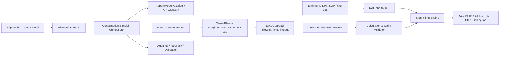

# Đề xuất chatbot phân tích và kể chuyện từ hệ thống Power BI

> Ngày nghiên cứu: 04/10/2026  
> Mục tiêu: giúp lãnh đạo nắm được điều gì đang xảy ra, vì sao, mức độ ảnh hưởng và hành động nên cân nhắc mà không phải tự đọc toàn bộ 10 báo cáo Power BI.

## 1. Kết luận đề xuất

Giải pháp nên **hỏi dữ liệu từ Power BI Semantic Model**, không nên lấy ảnh dashboard/PDF rồi yêu cầu AI “nhìn và đoán số”. Dashboard là lớp trình bày; Semantic Model mới chứa measure, quan hệ, bộ lọc và định nghĩa KPI đã được doanh nghiệp kiểm soát.

Hướng phù hợp nhất là triển khai theo hai tầng:

1. **Quick win trong Power BI**: chuẩn hóa 2 báo cáo quan trọng nhất rồi thử Copilot, narrative và email subscription có tóm tắt. Mục tiêu là xác nhận nhu cầu và chất lượng dữ liệu trong 2–3 tuần, gần như không phải xây một sản phẩm mới.
2. **Chatbot/Executive Brief tùy biến**: chỉ xây sau khi pilot chứng minh giá trị. Lớp này dùng Microsoft Entra ID để xác thực, định tuyến câu hỏi tới đúng Semantic Model, chạy truy vấn DAX, kiểm tra số liệu rồi mới dùng LLM viết phần storytelling. Đây là hướng cần thiết nếu phải tổng hợp xuyên nhiều báo cáo, gửi bản tin theo mẫu riêng, tích hợp Teams/email hoặc tạo cảnh báo chủ động.

Không nên bắt đầu bằng một chatbot RAG chỉ nạp PDF/ảnh chụp của 10 báo cáo. RAG phù hợp để tìm định nghĩa KPI, quy trình và chú giải; nó không phải nguồn chuẩn để tính toán số liệu động.

## 2. Bài toán thực sự cần giải

“Có 10 báo cáo” chưa đồng nghĩa với “có 10 nguồn dữ liệu”. Nhiều report có thể dùng chung một Semantic Model. Việc đầu tiên là lập bản đồ:

`Report -> Page -> Visual -> Semantic Model -> Measure -> Data source -> Owner`

Chatbot cần phục vụ hai kiểu nhu cầu khác nhau:

- **Pull / hỏi đáp**: “Doanh thu tháng này thế nào?”, “Vùng nào kéo lợi nhuận giảm?”, “So với kế hoạch còn thiếu bao nhiêu?”.
- **Push / chủ động**: mỗi sáng hoặc đầu tuần gửi một executive brief gồm điểm nổi bật, bất thường, nguyên nhân, rủi ro và liên kết để drill-down.

Một câu trả lời tốt không chỉ là đoạn văn trôi chảy. Nó phải có:

- số liệu và đơn vị;
- kỳ dữ liệu, thời điểm refresh và các filter đang áp dụng;
- so sánh với mục tiêu/kỳ trước/cùng kỳ;
- nguyên nhân được chứng minh bởi truy vấn;
- mức độ chắc chắn và giới hạn;
- liên kết về đúng report/page để kiểm tra;
- hành động đề xuất, nhưng tách rõ đâu là dữ kiện và đâu là khuyến nghị.

## 3. Bốn hướng thực hiện

### Hướng A — Dùng Copilot và narrative sẵn có của Power BI

Power BI hiện có khả năng tóm tắt report/page/visual, hỏi dữ liệu từ Semantic Model và tạo narrative. Copilot có thể đọc metadata của visual, giữ các ràng buộc RLS/OLS và trả lời theo trạng thái filter hiện tại. Email subscription cũng có thể kèm bản tóm tắt Copilot, nhưng tính năng này hiện có các giới hạn như chỉ hỗ trợ Standard Subscription, chưa hỗ trợ dynamic per-recipient subscription, paginated report, scorecard và dashboard.

**Phù hợp khi:** sếp đã dùng Power BI, câu hỏi chủ yếu nằm trong từng report, cần thử nhanh và tổ chức đã có paid Fabric/Premium capacity phù hợp.

**Ưu điểm:** nhanh nhất, ít code, bảo mật nằm trong hệ sinh thái Microsoft, có thể trả lời ngay trong trải nghiệm Power BI.

**Hạn chế:** ít quyền kiểm soát giọng kể và quy trình kiểm chứng; khó tạo một câu chuyện thống nhất xuyên nhiều Semantic Model; email summary không cho tùy biến prompt và chạy theo quyền của subscription owner; yêu cầu capacity/tenant setting phù hợp.

Nguồn: [Tổng quan Copilot với Power BI](https://learn.microsoft.com/en-us/power-bi/create-reports/copilot-reports-overview), [tóm tắt report bằng Copilot](https://learn.microsoft.com/en-us/power-bi/create-reports/copilot-pane-summarize-content), [Copilot summary trong email subscription](https://learn.microsoft.com/en-us/power-bi/create-reports/copilot-summaries-in-subscriptions), [yêu cầu bật Copilot và capacity](https://learn.microsoft.com/en-us/power-bi/create-reports/copilot-enable-power-bi).

### Hướng B — Microsoft Fabric Data Agent

Fabric Data Agent tạo trải nghiệm hỏi đáp tự nhiên trên Power BI Semantic Models và các nguồn Fabric. Với Semantic Model, agent sinh, kiểm tra và chạy DAX thông qua XMLA endpoint. Tài liệu hiện tại nêu một agent có thể kết hợp tối đa 5 data source; vì vậy cần kiểm kê xem 10 report thực tế dùng bao nhiêu model. Nếu vượt giới hạn, có thể chia agent theo domain (Sales, Finance, Operations...) và đặt một lớp router phía trước.

**Phù hợp khi:** doanh nghiệp đã dùng Fabric, muốn giải pháp ít code nhưng cần hội thoại trên nhiều nguồn có governance.

**Ưu điểm:** hiểu trực tiếp Semantic Model, tận dụng business logic, AI Instructions và Verified Answers; có thể kết hợp structured/unstructured source trong Fabric.

**Hạn chế:** phụ thuộc Fabric capacity, giới hạn và trạng thái preview cần được xác nhận lại trong tenant trước khi chọn cho production; khả năng tùy biến UX/workflow thấp hơn app riêng.

Nguồn: [Khái niệm Fabric Data Agent](https://learn.microsoft.com/en-us/fabric/data-science/concept-data-agent), [thêm data source vào Data Agent](https://learn.microsoft.com/en-us/fabric/data-science/data-agent-add-datasources), [best practices cho Semantic Model](https://learn.microsoft.com/en-us/fabric/data-science/semantic-model-best-practices).

### Hướng C — Xây chatbot tùy biến trên Power BI API (khuyến nghị cho đích dài hạn)

Ứng dụng đăng nhập bằng Microsoft Entra ID, nhận câu hỏi, chọn đúng model, tạo hoặc chọn truy vấn DAX, gọi Execute Queries API, kiểm tra kết quả và đưa **chỉ phần dữ liệu tổng hợp cần thiết** cho LLM viết câu chuyện. API hiện hỗ trợ truy vấn DAX trên Semantic Model, nhưng có giới hạn về số request, kích thước kết quả và quyền truy cập; thiết kế phải chủ động xử lý các giới hạn này.

**Phù hợp khi:** cần tổng hợp toàn bộ 10 báo cáo, có executive brief riêng, chat trong Teams/web, lịch gửi chủ động, cảnh báo bất thường, logging/evaluation và kiểm soát câu trả lời.

**Ưu điểm:** linh hoạt nhất; có thể tạo một “lớp biên tập điều hành” chung; câu trả lời có citation nội bộ, link drill-down, audit trail và quy trình duyệt.

**Hạn chế:** cần đội kỹ thuật, data owner và người kiểm thử nghiệp vụ; phải tự xử lý auth, RLS/OLS, guardrail, quan sát hệ thống và chất lượng DAX.

Nguồn: [Power BI Execute Queries API](https://learn.microsoft.com/en-us/rest/api/power-bi/datasets/execute-queries), [giới hạn Execute DAX Queries](https://learn.microsoft.com/en-us/rest/api/power-bi/datasets/execute-dax-queries), [bảo mật Power BI Embedded](https://learn.microsoft.com/en-us/power-bi/developer/embedded/embedded-row-level-security), [capacity cho Embedded](https://learn.microsoft.com/en-us/power-bi/developer/embedded/embedded-capacity).

### Hướng D — Đọc screenshot/PDF bằng OCR hoặc vision

Chỉ nên dùng làm fallback cho report legacy không thể truy cập model. Cách này dễ làm demo nhưng yếu về độ tin cậy: số bị làm tròn, filter không rõ, chart có thể ẩn dữ liệu, không drill-down được và khó giữ RLS. Nếu bắt buộc dùng, mọi con số phải gắn tọa độ/ảnh nguồn và có cơ chế người duyệt.

## 4. So sánh nhanh

| Tiêu chí | A. Power BI Copilot | B. Fabric Data Agent | C. Custom chatbot | D. OCR/ảnh |
|---|---:|---:|---:|---:|
| Thời gian ra pilot | Rất nhanh | Nhanh | Trung bình | Nhanh |
| Tổng hợp xuyên nhiều model | Thấp–trung bình | Khá, có giới hạn nguồn | Tốt nhất | Thấp |
| Tùy biến storytelling/workflow | Thấp | Trung bình | Tốt nhất | Trung bình |
| Độ tin cậy số liệu | Cao nếu model tốt | Cao nếu model tốt | Cao nếu có guardrail | Thấp–trung bình |
| Governance/RLS | Tích hợp sẵn | Tích hợp hệ sinh thái | Phải thiết kế đúng | Khó đảm bảo |
| Chi phí phát triển | Thấp | Thấp–trung bình | Trung bình–cao | Thấp lúc đầu, cao khi vận hành |
| Phù hợp production dài hạn | Có, cho use case đơn giản | Có điều kiện | Có | Không khuyến nghị |

**Quyết định đề xuất:** bắt đầu bằng A để kiểm chứng và chuẩn hóa dữ liệu; chọn B nếu công ty đã đầu tư mạnh vào Fabric; chọn C khi yêu cầu cốt lõi là bản tin tổng hợp xuyên 10 report và trải nghiệm riêng. D chỉ là giải pháp tạm.

## 5. Kiến trúc khuyến nghị cho chatbot tùy biến

### Nguyên tắc thiết kế

1. **Tính trước, kể sau**: DAX/logic xác định số; LLM chỉ giải thích và sắp xếp câu chuyện. Không cho LLM tự nhẩm chênh lệch hoặc phần trăm nếu có thể tính bằng code/DAX.
2. **Template trước, sinh DAX sau**: 20–30 câu hỏi điều hành phổ biến nên dùng query template đã kiểm duyệt. NL-to-DAX dành cho câu hỏi mở và phải qua kiểm tra.
3. **RAG chỉ cho kiến thức tĩnh**: định nghĩa “doanh thu thuần”, ngưỡng cảnh báo, quy trình, owner KPI. Số liệu động luôn lấy từ Semantic Model.
4. **Mọi claim quan trọng phải truy vết được**: lưu model ID, measure, DAX, filter, thời điểm refresh và deep link.
5. **Không để một prompt tùy ý chạm thẳng API**: router và policy quyết định model/measure nào được truy cập.

## 6. Chuẩn storytelling cho lãnh đạo

Thay vì trả một đoạn mô tả dài, mỗi bản tin nên có cấu trúc cố định:

1. **Headline** — một câu nói điều quan trọng nhất.
2. **Kết quả** — KPI hiện tại, mục tiêu, chênh lệch tuyệt đối và phần trăm.
3. **Diễn biến** — so với kỳ trước/cùng kỳ; nêu điểm đổi chiều.
4. **Driver** — 2–3 phân khúc đóng góp lớn nhất, có số chứng minh.
5. **Rủi ro/cơ hội** — chỉ phát biểu nếu có rule hoặc dữ liệu hỗ trợ.
6. **Hành động** — người/phòng ban nên kiểm tra gì tiếp theo; đây là đề xuất, không trình bày như dữ kiện.
7. **Nguồn** — report/page, kỳ dữ liệu, filter và thời điểm refresh.

Ví dụ đầu ra mong muốn:

> **Doanh thu tháng 9 thấp hơn kế hoạch 8,2%, chủ yếu do miền Nam và nhóm A.** Doanh thu đạt 91,8 tỷ/100 tỷ, giảm 4,1% so với tháng 8 nhưng vẫn tăng 6,0% so với cùng kỳ. Miền Nam đóng góp 5,3 tỷ trong tổng mức thiếu 8,2 tỷ; nhóm A đóng góp thêm 1,7 tỷ. Cần kiểm tra tồn kho và tỷ lệ chuyển đổi của hai nhóm này trước cuộc họp thứ Hai.  
> Nguồn: Sales Executive / Overview · kỳ 01–30/09 · đơn vị tỷ VND · refresh 06:15 01/10.

Các con số trên chỉ minh họa format, không phải số liệu doanh nghiệp.

## 7. Chuẩn bị 10 báo cáo trước khi làm AI

Đây là phần quyết định thành bại. Microsoft cũng khuyến nghị sửa model, relationship và aggregation trước; prompt không thể sửa một mô hình dữ liệu sai.

### 7.1. Inventory bắt buộc

Tạo một bảng cho từng report/model với các trường:

- workspace, report ID, report page, Semantic Model ID;
- owner nghiệp vụ và owner kỹ thuật;
- danh sách KPI/measure quan trọng;
- nguồn dữ liệu, lịch refresh, timezone, độ trễ;
- RLS/OLS, nhóm người được xem;
- định nghĩa kỳ so sánh và target;
- report/model nào trùng KPI hoặc mâu thuẫn định nghĩa;
- link đến report/page/bookmark.

### 7.2. Làm Semantic Model “AI-ready”

- dùng measure chuẩn thay vì để AI cộng trực tiếp cột nghiệp vụ;
- đặt tên table/column/measure dễ hiểu, thêm mô tả và synonym;
- ẩn field kỹ thuật hoặc field gây nhập nhằng;
- sửa relationship, data type, format và default summarization;
- xây **AI data schema** chỉ gồm field cần cho lãnh đạo;
- thêm **AI Instructions** về thuật ngữ, cách so sánh, fiscal calendar và ưu tiên phân tích;
- tạo **Verified Answers** cho các câu hỏi quan trọng như doanh thu, lợi nhuận, cash flow, backlog;
- chỉ đánh dấu model “Approved for Copilot” sau khi qua bộ test.

Nguồn: [Prepare data for AI](https://learn.microsoft.com/en-us/power-bi/create-reports/copilot-prepare-data-ai), [AI Instructions](https://learn.microsoft.com/en-us/power-bi/create-reports/copilot-prepare-data-ai-instructions), [Verified Answers](https://learn.microsoft.com/en-us/power-bi/create-reports/copilot-prepare-data-ai-verified-answers), [đánh giá Semantic Model cho Copilot](https://learn.microsoft.com/en-us/power-bi/create-reports/copilot-evaluate-data).

### 7.3. KPI Registry dùng chung

Tạo một registry có version để giải quyết việc cùng một KPI nằm ở nhiều report:

| Trường | Ví dụ |
|---|---|
| `canonical_name` | Net Revenue |
| `business_aliases` | doanh thu thuần, net sales |
| `semantic_model_id` | model Sales |
| `measure_name` | `[Net Revenue]` |
| `definition` | doanh thu sau hoàn/giảm giá... |
| `grain` | ngày × chi nhánh × sản phẩm |
| `currency/timezone` | VND / Asia-Saigon |
| `comparison_rule` | MTD so với kế hoạch và cùng kỳ |
| `owner` | Finance Controller |
| `sensitivity` | Internal/Confidential |

## 8. Bảo mật và quản trị

- Với chatbot nội bộ, ưu tiên **user-owns-data / delegated identity** để câu hỏi chạy dưới danh tính người đang đăng nhập và bám quyền Power BI hiện có.
- RLS/OLS phải được thực thi ở Semantic Model, không chỉ bằng prompt hoặc filter ở giao diện.
- Service principal chỉ được cấp vào workspace/model cần thiết. Nếu dùng effective identity/role cho Embedded hoặc truy vấn tự động, phải kiểm thử bằng token thật; không giả định rằng role trên Power BI Service tự động hoạt động giống mọi kịch bản embed.
- Không gửi toàn bộ dataset sang LLM. Chỉ gửi bảng kết quả đã tổng hợp và tối thiểu hóa dữ liệu nhạy cảm/PII.
- Lưu audit: người hỏi, câu hỏi, model được chọn, DAX/template, filter, kết quả hash, model LLM/version, câu trả lời và feedback.
- Chống prompt injection bằng allowlist model/measure, giới hạn dòng/kích thước, timeout, parser/validator DAX và từ chối truy vấn ngoài phạm vi.
- Với bản tin gửi hàng loạt, phải xác định rõ chạy theo quyền của ai. Copilot email subscription chạy thay mặt subscription owner; do đó không dùng một bản tóm tắt chứa dữ liệu rộng hơn quyền của từng người nhận.
- Nội dung tác động đến quyết định lớn nên có workflow “AI soạn — analyst duyệt — gửi”, ít nhất trong giai đoạn đầu.

## 9. Kiểm thử để tránh chatbot “nói hay nhưng sai”

Tạo bộ **golden questions** từ câu hỏi thật của sếp và đáp án do analyst xác nhận. MVP nên có ít nhất 50 câu, bao phủ:

- KPI đơn lẻ, top/bottom, xu hướng;
- so với target, kỳ trước, cùng kỳ;
- drill-down theo vùng/sản phẩm/kênh;
- câu hỏi mơ hồ cần hỏi lại;
- dữ liệu chưa refresh hoặc thiếu;
- người dùng khác quyền RLS;
- câu hỏi ngoài phạm vi phải từ chối;
- tổng hợp xuyên hai model.

Chấm riêng từng lớp: chọn đúng model, đúng measure, đúng filter/thời gian, DAX chạy đúng, số khớp, narrative không thêm claim, link nguồn đúng và không rò rỉ dữ liệu.

Ngưỡng nghiệm thu đề xuất cho pilot (đây là mục tiêu nội bộ, không phải chuẩn của Microsoft):

- 100% test bảo mật/RLS quan trọng phải đạt;
- >= 98% câu hỏi chuẩn có số liệu khớp với kết quả analyst;
- >= 90% câu hỏi định tuyến đúng model ngay lần đầu;
- 0 claim định lượng không có nguồn truy vấn;
- p95 thời gian trả lời dưới 15 giây cho câu hỏi một model;
- ít nhất 80% người dùng pilot đánh giá bản tóm tắt “giúp tiết kiệm thời gian”.

## 10. Lộ trình MVP 6 tuần

### Tuần 1 — Discovery và đo baseline

- chọn 2 report có giá trị cao và 3–5 lãnh đạo/analyst pilot;
- thu thập 30–50 câu hỏi thật và 5 mẫu bản tin hiện tại;
- inventory report/model/quyền/refresh;
- đo thời gian hiện tại để chuẩn bị báo cáo họp.

**Đầu ra:** use-case backlog, sơ đồ nguồn, golden questions v0, tiêu chí thành công.

### Tuần 2 — Chuẩn hóa semantic layer

- chốt KPI dictionary và owner;
- sửa tên/description/relationship/measure;
- cấu hình AI data schema, AI Instructions, Verified Answers;
- kiểm tra RLS/OLS.

**Gate:** nếu cùng KPI còn nhiều định nghĩa chưa thống nhất thì chưa xây chatbot.

### Tuần 3 — Quick win native Power BI

- bật Copilot trong workspace pilot nếu license/capacity cho phép;
- thử report summary, visual summary và subscription summary;
- so kết quả với golden questions, thu feedback.

**Quyết định:** nếu native đã đáp ứng phần lớn nhu cầu thì không cần custom app ngay.

### Tuần 4 — Custom chatbot mỏng

- Entra login;
- catalog 2 model;
- 10–15 DAX template cho câu hỏi phổ biến;
- trả lời theo format storytelling và gắn link nguồn;
- log truy vấn, filter, refresh time và feedback.

### Tuần 5 — Executive Brief

- lịch chạy theo ngày/tuần;
- rule phát hiện chênh lệch/anomaly;
- sinh bản nháp, analyst duyệt rồi gửi;
- không gửi nếu dữ liệu stale, kiểm tra thất bại hoặc độ tin cậy thấp.

### Tuần 6 — Đánh giá và quyết định mở rộng

- chạy lại toàn bộ golden set và security test;
- đo thời gian tiết kiệm, chất lượng, latency và chi phí;
- quyết định mở rộng dần lên 10 report theo domain, không onboard đồng loạt.

## 11. Ước lượng nguồn lực và chi phí

Không nên ghi giá license cố định trong thiết kế vì SKU và giá thay đổi theo vùng/thời điểm. Cần kiểm tra lại tenant và trang giá Microsoft khi lập ngân sách.

Nguồn lực tối thiểu cho pilot:

- 1 Power BI/Data owner: chuẩn hóa measure, model, RLS;
- 1 backend/AI engineer: auth, Power BI API, orchestration, logging;
- 1 analyst/người đại diện nghiệp vụ: golden questions và duyệt câu chuyện;
- security/admin hỗ trợ tenant setting, Entra app và capacity.

Chi phí cần tách riêng:

1. Power BI Pro/PPU/Fabric/Embedded capacity hiện có hay phải mua thêm;
2. LLM token và hạ tầng app/logging;
3. công sức làm sạch Semantic Model — thường là phần lớn nhất nhưng cũng tạo giá trị lâu dài;
4. vận hành: kiểm thử khi measure/report thay đổi, feedback và audit.

Tài liệu Microsoft cho biết Copilot cần paid Fabric capacity hoặc Power BI Premium capacity phù hợp và không hỗ trợ trial capacity; mô hình Embedded production cũng có yêu cầu capacity/license theo kịch bản. Cần đối chiếu trực tiếp tenant trước khi chốt ngân sách: [Power BI/Fabric licensing](https://learn.microsoft.com/en-us/fabric/enterprise/powerbi/service-admin-power-bi-licensing), [Embedded capacity và SKU](https://learn.microsoft.com/en-us/power-bi/developer/embedded/embedded-capacity).

## 12. Những sai lầm nên tránh

- Cho AI đọc ảnh dashboard rồi coi đó là nguồn chuẩn.
- Đổ cả dataset vào vector database; embedding không thay thế phép tính BI.
- Bắt đầu với cả 10 report trước khi thống nhất KPI.
- Chỉ đánh giá “câu trả lời nghe hợp lý” mà không so số/DAX/filter.
- Để LLM tự sinh mọi truy vấn ngay từ MVP.
- Dùng một service account quyền rộng cho mọi người mà không tái áp dụng RLS.
- Gửi executive brief khi data refresh lỗi hoặc không hiển thị “as of”.
- Đưa ra khuyến nghị hành động nhưng không tách nó khỏi dữ kiện đã xác minh.

## 13. Các câu hỏi cần trả lời trước buổi kickoff

1. 10 report đang dùng bao nhiêu Semantic Model và nằm ở những workspace nào?
2. Công ty đang có Power BI Pro, PPU, Premium hay Fabric SKU nào?
3. Tenant/region đã cho phép Copilot và dữ liệu được phép xử lý theo chính sách nào?
4. Có RLS/OLS không; các sếp có cùng quyền dữ liệu hay khác nhau?
5. Kênh chính là Power BI, Teams, web, email hay ứng dụng khác?
6. Cần hỏi đáp theo yêu cầu, bản tin chủ động, hay cả hai?
7. Năm KPI quan trọng nhất và “mục tiêu/kỳ so sánh” chính xác là gì?
8. Ai là người có quyền xác nhận định nghĩa KPI và duyệt narrative?
9. Dữ liệu được refresh lúc nào; độ trễ tối đa chấp nhận được?
10. Có yêu cầu lưu lịch sử hội thoại, audit, DLP hoặc cấm dữ liệu ra ngoài region không?

## 14. Đề xuất hành động ngay

Trong tuần đầu, chưa cần viết chatbot hoàn chỉnh. Hãy chọn **Sales/Finance hoặc hai report được xem nhiều nhất**, lập inventory, thu 30–50 câu hỏi thật từ lãnh đạo và chuẩn hóa 5 KPI cốt lõi. Sau đó thử Copilot/native summary trên cùng bộ câu hỏi. Khoảng cách giữa kết quả native và tiêu chí nghiệp vụ sẽ cho biết có cần Fabric Data Agent hay custom chatbot, đồng thời tránh đầu tư lớn vào một bài toán chưa được định nghĩa.

MVP được xem là thành công khi lãnh đạo nhận được một bản tin ngắn có số đúng, biết lý do chính, bấm được về nguồn và tiết kiệm thời gian chuẩn bị/đọc báo cáo — không phải khi chatbot trả lời được mọi câu hỏi.
